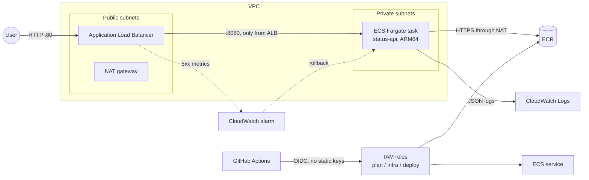

# status-api

Small Go HTTP service running on AWS ECS Fargate. Infrastructure is Terraform + Terragrunt, CI/CD is GitHub Actions.

- `GET /health` returns `200 {"status":"ok"}`
- `GET /` returns the value of `GREETING` (different for dev and prod)

Dev (while it is running): http://status-api-dev-709996212.eu-central-1.elb.amazonaws.com

## Repository layout

```
app/                 Go service, tests, Dockerfile
infra/
  modules/           own Terraform modules: ecr, github-oidc, ecs-service
  live/
    root.hcl         shared S3 backend and AWS provider
    dev/ prod/       same units, only env.hcl is different
.github/workflows/   CI for pull requests, CD for main
mise.toml            pinned tool versions, used on a laptop and in CI
```

## Architecture



- The ALB is the only public entrypoint. Tasks have no public IP and accept traffic only from the ALB security group.
- Tasks reach ECR and CloudWatch over HTTPS through NAT (one NAT in dev, one per AZ in prod).
- The execution role can pull from one ECR repository and write to one log group. There is no task role, because the app does not call any AWS API.
- The app logs JSON to stdout (`log/slog`), ECS sends it to CloudWatch Logs.

## Run locally

Tool versions are in `mise.toml` (`mise install` installs all of them).

```bash
cd app
go test ./...
GREETING="hello from laptop" go run .
curl localhost:8080/health
```

With Docker (multi-stage build, distroless image, runs as non-root uid 65532):

```bash
docker build -t status-api app
docker run --rm -p 8080:8080 -e GREETING="hello from docker" status-api
```

## Infrastructure

### Check the code without an AWS account

The same checks run in CI on every pull request:

```bash
terraform fmt -check -recursive infra
terragrunt hcl fmt --check --working-dir infra/live
for m in infra/modules/*/; do terraform -chdir="$m" init -backend=false && terraform -chdir="$m" validate; done
tflint --init --config "$PWD/infra/.tflint.hcl"
tflint --recursive --chdir infra/modules --config "$PWD/infra/.tflint.hcl"
trivy config infra/modules
```

### Who deploys what (chicken and egg)

CI needs IAM roles to talk to AWS, so it can not create them itself. An admin creates the minimum once, everything else goes through pull requests and pipelines.

| Part | Deployed by | Why |
|---|---|---|
| State bucket, `ecr`, `github-oidc` | admin, once | CI needs them before it can run. CI must never change its own permissions (`exclude` block in the unit and an explicit `Deny` in IAM) |
| `network`, `ecs-service` | `infra-cd` after merge | normal changes, reviewed in a PR with a plan |
| Image and task definition revision | `app-cd` after merge | one image per commit, immutable tag |

First deployment:

1. Set `account_id` in `infra/live/dev/env.hcl`.
2. With admin credentials:
   ```bash
   cd infra/live/dev/ecr && terragrunt backend bootstrap && terragrunt apply
   cd ../github-oidc && terragrunt apply
   ```
3. In GitHub create environments `dev` and `dev-infra` (deployments only from `main`) and repository variables `AWS_PLAN_ROLE_ARN`, `AWS_INFRA_ROLE_ARN`, `AWS_DEPLOY_ROLE_ARN` (`terragrunt output` in `github-oidc`).
4. Merge a PR, `infra-cd` creates the network and the ECS service.
5. Run `app-cd` (`gh workflow run app-cd.yml --ref main`), it builds and deploys the first image.

### dev and prod

Both environments use the same modules and the same unit files. Only `env.hcl` is different, so prod is created by configuration, not by copying code.

| | dev | prod |
|---|---|---|
| AWS account | dev account | own account (not created) |
| AZs / NAT gateways | 2 / 1 shared | 3 / one per AZ |
| Tasks | 1 x 0.25 vCPU | 2 x 0.5 vCPU |
| Log retention | 14 days | 90 days |
| VPC flow logs, Container Insights | off | on |
| ALB deletion protection | off | on |

### Terraform state isolation

- One S3 bucket per AWS account: `status-api-tfstate-<account_id>`. Terragrunt creates it with versioning, KMS encryption, public access block and a TLS-only policy.
- One state file per environment and unit, e.g. `dev/ecs-service/terraform.tfstate`. A broken change in one unit can not touch the others, and plans are faster.
- Locking with the S3 lock file (`use_lockfile = true`, Terraform 1.10+), no DynamoDB table.
- Prod is meant to live in a seperate AWS account, so it gets a seperate bucket, OIDC provider and roles. `allowed_account_ids` in the provider blocks applying dev config to the prod account and the other way round.

## CI/CD

| Workflow | Trigger | What it does | AWS access |
|---|---|---|---|
| `app-ci` | PR with changes in `app/` | golangci-lint, tests, image build, Trivy image scan | none |
| `infra-ci` | PR with changes in `infra/` | fmt, validate, tflint, `terragrunt plan` for dev | read-only |
| `security` | every PR, main, weekly | Trivy on the whole repo: Go dependencies, secrets, Terraform and Dockerfile | none |
| `app-cd` | merge to main with changes in `app/` | runs `app-ci` again, build, scan, push to ECR, deploy to ECS | deploy role |
| `infra-cd` | merge to main with changes for dev | `terragrunt run --all apply` for dev | infra role |

Security decisions:

- No AWS keys in GitHub. OIDC gives short-lived credentials (1 hour). The only GitHub variables are role ARNs.
- Three roles, each trusts only one OIDC `sub` claim:
  - `plan`: pull requests only, `ReadOnlyAccess`. Code from a PR never gets write access.
  - `infra`: environment `dev-infra` only. `PowerUserAccess` plus IAM limited to `status-api-dev-*` roles, with an explicit deny on the CI roles.
  - `deploy`: environment `dev` only. Push to one ECR repository, update one ECS service, pass one role.
- The trust policy uses GitHub's immutable subject (`repo:owner@id/name@id`), so a deleted and re-created repo with the same name can not assume the roles.
- `permissions: {}` at the top of every workflow, each job asks only for what it needs. `persist-credentials: false`, job timeouts, no `pull_request_target`, no `${{ }}` inside shell scripts (values go through env variables).
- Actions are pinned to commit SHAs and updated by Dependabot. Only three actions are used; tools are installed by mise with pinned versions.
- Path filters keep the app and infra pipelines apart. `security` has no path filter, so it is the check to mark as required in branch protection (a workflow skipped by a path filter never reports a status and would block the PR).
- Trivy replaces tfsec (tfsec rules are part of Trivy now). Builds fail on HIGH and CRITICAL findings with a fix available. Accepted findings are marked in code with `#trivy:ignore` and a reason.
- Deployments are queued with `concurrency`, never cancelled in the middle.

## Prod promotion and rollback

Not implemented, this is how I would do it:

1. GitHub environments `prod` and `prod-infra` with required reviewers and deployments only from `main`. The approval is the gate before every prod change.
2. Infra: PR with changes in `infra/live/prod`, plan in the PR, apply after merge and approval.
3. App: no new build for prod. The image tested on dev is copied by digest to the prod ECR (ECR replication or `crane copy`) and deployed with the same steps and the prod role.

Rollback:

- Automatic: the ALB checks `/health` every 15 seconds. Old tasks serve traffic until new tasks are healthy (minimum healthy 100%). If new tasks fail the health check, the ECS deployment circuit breaker stops the rollout and goes back to the last working task definition. The 5xx alarm is attached to the deployment too, so a spike of errors also triggers a rollback.
- The pipeline notices it: `aws ecs wait services-stable` also succeeds after a rollback, so `app-cd` compares the running task definition with the one it registered and fails if they differ.
- Manual and fast, no rebuild needed because images and task definitions are immutable:
  ```bash
  aws ecs update-service --cluster status-api-prod --service status-api-prod --task-definition status-api-prod:<previous revision>
  ```

When `/health` stops responding after a deployment, the new tasks never get traffic, the circuit breaker rolls back, `app-cd` goes red and the team fixes forward with a new PR. If `/health` stops responding later (not during a deploy), ECS replaces unhealthy tasks, the 5xx alarm fires and on-call decides between a manual rollback and a fix.

## Monitoring for prod

Already there: JSON logs in CloudWatch, 5xx alarm (ALB and target errors) used for deployment rollback.

For prod I would add:

- Alarms to SNS, then Slack or PagerDuty: 5xx rate, `UnHealthyHostCount > 0`, p95/p99 `TargetResponseTime`, ECS CPU and memory above 80%, running tasks below desired count.
- An external check on `/health` (Route 53 health check or CloudWatch Synthetics canary), it also catches DNS and ALB problems.
- Container Insights and VPC flow logs (already on in prod `env.hcl`), ALB access logs to S3.
- A dashboard, an availability SLO and a log metric filter on `"level":"ERROR"`.

## Key decisions and trade-offs

- **ECS Fargate instead of EC2:** no servers, AMIs or patching. Each task has its own security group and IAM role. Rolling deploys, health checks and rollback are built in. EC2 would be cheaper at bigger scale, but needs much more work. EKS would add a control plane ($73/month) and many moving parts for one small service.
- **ARM64 (Graviton):** about 20% cheaper on Fargate. Go cross-compiles in the Dockerfile, so CI does not need QEMU.
- **Terragrunt:** backend and provider are defined once, every unit has its own state, dependencies between units are explicit, and environments differ only by `env.hcl`.
- **Community VPC module** (`terraform-aws-modules/vpc`, pinned version) instead of writing my own network code. Own modules only where the logic is specific to this service.
- **CI owns the image version, Terraform owns the rest.** The ECS service ignores `task_definition` changes, so `terraform apply` never rolls back an image deployed by CI. Trade-off: a change of `GREETING` goes live with the next app deployment (or a manual `app-cd` run).
- **Immutable image tags** (git SHA): a tag always means the same image. `app-cd` reuses an existing image when a commit is deployed again.
- **NAT instead of VPC endpoints:** in dev one NAT is cheaper than interface endpoints for ECR and CloudWatch in 2 AZs. In prod endpoints would also keep AWS traffic off the internet.
- **HTTP only:** there is no domain in this task, so no certificate.

## What I skipped and what I would do next

- HTTPS with ACM and Route 53, redirect from HTTP, AWS WAF on the ALB.
- Auto scaling of the ECS service (target tracking on CPU or request count).
- A permissions boundary for the `infra` role. Now it can create IAM roles with the `status-api-dev-*` prefix, a boundary would stop privilege escalation through those roles.
- KMS customer managed keys for logs and ECR (accepted LOW findings from Trivy).
- The prod pipeline itself (only described above).
- Image signing (cosign), SBOM, upload of scan results to the GitHub Security tab.
- Branch protection as code, more tests than the handler tests.

## Assumptions

- Region `eu-central-1`.
- One AWS account per environment, only dev exists.
- No domain, so the ALB listens on HTTP.
- The app needs no secrets and no AWS API access. From the optional tasks I picked the CloudWatch 5xx alarm.
